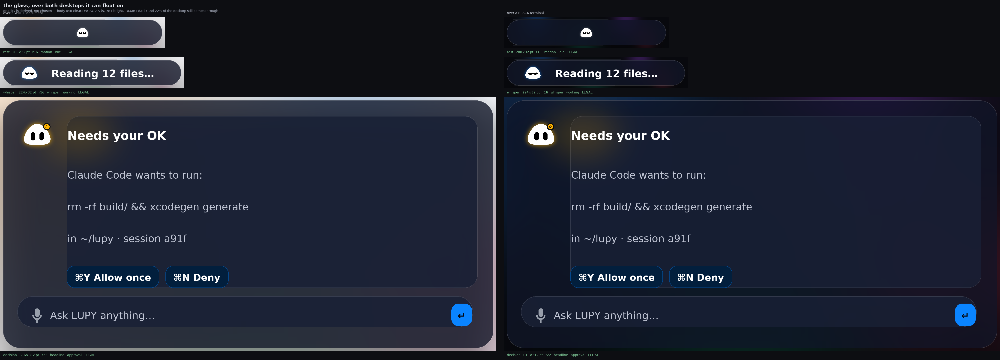
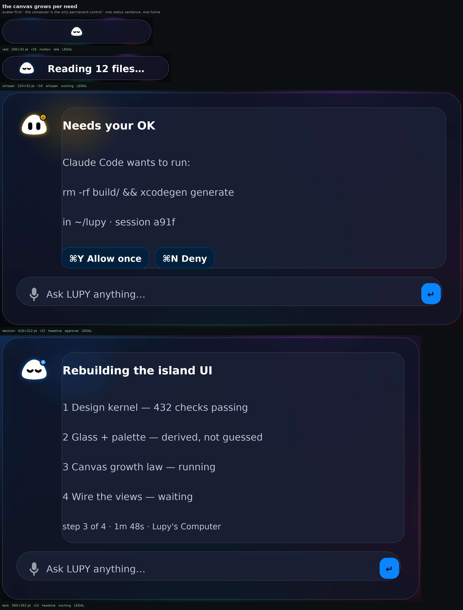
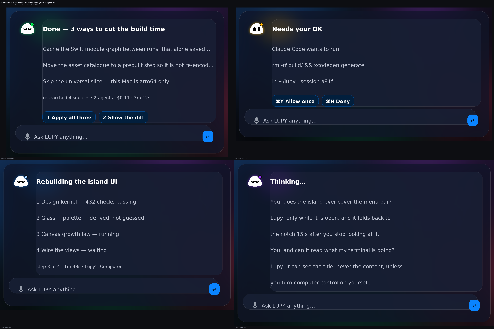

> **Start here instead:** [ISLAND_WALKTHROUGH.md](ISLAND_WALKTHROUGH.md) — three pictures, three questions.

# LUPY's island — three pictures to look at before you choose

Boss, this page is the whole island design in three pictures. Everything in them is
**computed by the law** (`Mac/Sources/Lupy/UI/LupyIslandDesign.swift`) and drawn by a
script that is only allowed to fill the boxes the law prints — nothing is drawn by hand,
so if a picture looks wrong, the rule is wrong and I fix the rule.

473 checks guard these pictures: `tools/ui/test-design.sh` (runs on your Mac, no GitHub
needed). The full argument lives in `docs/LUPY3_ISLAND_LAW.md`.

---

## Picture 1 — the glass, over both desktops it can float on

The same three islands twice: left half over a **white document**, right half over a
**black terminal**. The island is frosted glass — 22% of your desktop still comes through
it, blurred and colour-pushed — and the text stays readable on both sides. That opacity
is not a number I liked; it is the smallest one at which body text clears the WCAG AA
readability floor over *both* extremes (measured 8.95:1 bright, 18.41:1 dark; the floor
is 4.5:1).

Look at:
- **rest** (top): just LUPY under the camera. No words. At that size his colour and his
  motion are the message.
- **whisper** (middle): one line beside him, *"Reading 12 files…"*. The band does not
  change shape — it only fills.
- **needs-you** (bottom): he turns amber, opens his eyes, puts the badge on his right
  rim, and the card grows to hold the command and the ⌘Y / ⌘N answers. The mic + field
  at the foot is the only control that is always there.

---

## Picture 2 — the canvas grows per need, never fixed

Top to bottom: rest → whisper → the approval card → the task ledger. The size you see is
a function of what each one has to show. Nothing is a hand-tuned height any more; the old
island carried a table of 22 fixed heights and that is what made every screen feel like
the same box wearing a costume.

Look at:
- LUPY is always top-left of the card, the same size, saying the headline beside him —
  **one status sentence, one home**, never repeated and never on his head.
- His light is the state: amber when he needs your OK, blue while he works. The app's
  accent *is* his working blue. No mango anywhere.
- The card is its own lifted glass; the composer is glass too; the hairline and the soft
  shadow are the Synvy-Neuro recipe from your reference.
- It is always **wider than tall**. A portrait island is a phone panel, and you rejected
  those twice.

---

## Picture 3 — the four surfaces waiting for your approval

Same law, four needs, drawn at a readable size so you can pick the first one I build for
real in the app:

| | |
|---|---|
| **top-left — the answer bloom** | streaming text, the sources + cost line (*"researched 4 sources · 2 agents · $0.11 · 3m 12s"*), quick replies ⌘1 / ⌘2. LUPY green and resting-eyes: he's done. |
| **top-right — needs-your-OK** | the command in evidence, ⌘Y allow / ⌘N deny, and a queue count when more than one waits. LUPY amber, eyes open. |
| **bottom-left — the task ledger** | plan + numbered steps while he works, with room for a live preview of Lupy's Computer beside it. LUPY blue, ∪∪ lids, working. |
| **bottom-right — the conversation** | your words and his, streaming, tallest canvas the island owns. LUPY violet and thinking. |

Two more sheets exist in this folder if you want to see everything at once:
`lupy-island-surfaces.png` (answer, chat, question, error, listening) and
`lupy-island-all.png` (all nine).

---

## What happens after you choose

I wire that one surface to the law in the real SwiftUI (`LupyIslandCanvas.swift` is the
ready-made bridge), show you the render, and only then move to the next. A frame must
follow the content drawn in it, so moving them one at a time is what keeps your island
from ever showing a clipped card or a dead empty box.

**Tell me which of the four to build first.**
