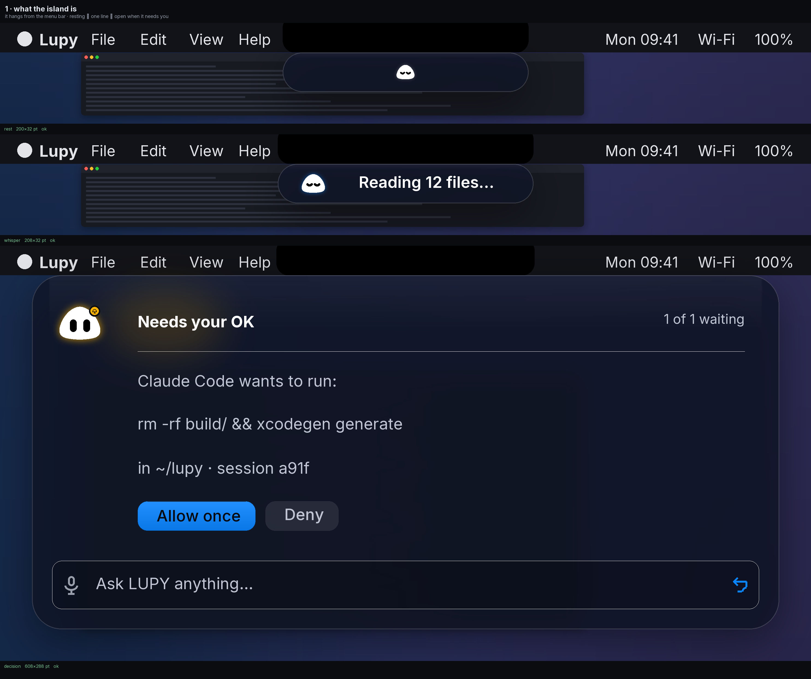
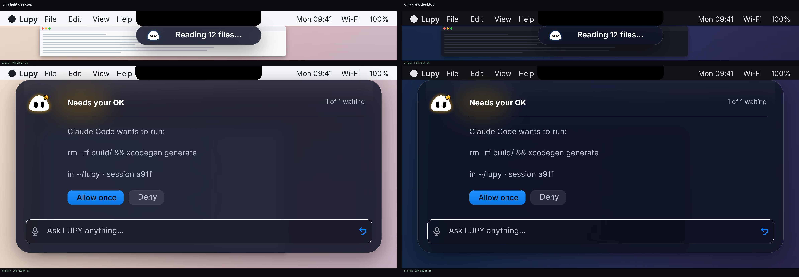
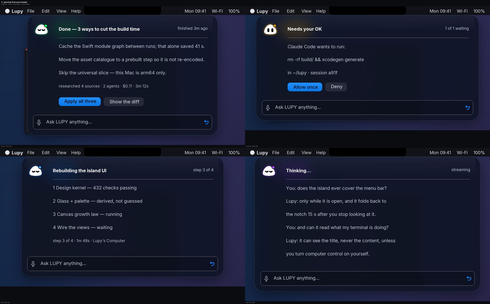
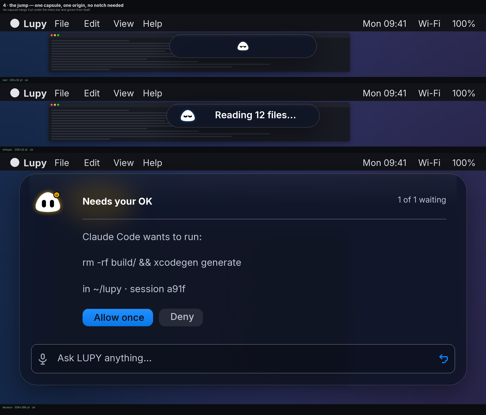

# LUPY's island — look at this, then answer one question

Boss, three pictures. Each one has **what you are seeing** and **the one question** it
needs answered. Nothing else. (The maths behind every pixel is in
`docs/LUPY3_ISLAND_LAW.md` if you ever want it; you don't need it here.)

These are true-to-size drawings of the design, made by a script that is only allowed to
fill the boxes the island's rules compute — so what you see here is what the app will
measure. They are not screenshots of a running Mac; there is no Mac in this sandbox. When
I wire a surface into the app, you'll get the real screenshot from your own machine.

---

## Picture 1 — what the island is

Three moments, top to bottom, on a real desktop with the menu bar above:

1. **Doing nothing.** The island is just the notch, with LUPY in it. No text. His colour
   and his breathing are the message.
2. **Working.** The band stays the same size and one line appears beside him:
   *Reading 12 files…* He stays small; the words do the talking.
3. **Needing you.** It opens. He turns amber and opens his eyes. The card says what he
   wants, shows the exact command, and gives you **Allow once** / **Deny** buttons. The
   typing box at the bottom is always there — it is the only control that never leaves.

**Question 1:** is that the right amount of island for those three moments — or should
the working line be bigger, smaller, or gone?

---

## Picture 2 — the glass, on the two worst desktops

The same two islands twice: left over a **light** desktop, right over a **dark** one.
The panel is frosted glass — your wallpaper still shows through it, blurred. The rule I
proved: the writing stays readable on *both*, including over a white document, which is
the case every glass UI fails.

**Question 2:** do you like how dark the glass is? I can make it lighter (more wallpaper
showing, slightly less contrast) or deeper (calmer, more contrast). Say "lighter",
"deeper", or "leave it".

---

## Picture 3 — pick the first one I build for real

Four surfaces, all from the same rules. Top-left **A**, top-right **B**, bottom-left
**C**, bottom-right **D**:

- **A — the answer.** He finished something. What he found, where it came from
  (*researched 4 sources · 2 agents · $0.11*), and two buttons: apply it, or show the
  diff. He is green and calm.
- **B — needs your OK.** A program wants to run a command. You see the command, the
  session, and Allow / Deny. He is amber with open eyes.
- **C — the work list.** While he works: the plan, numbered steps, how far along
  (*step 3 of 4*). He is blue with his working lids.
- **D — the conversation.** You talking and him answering, live. The tallest the island
  gets. He is violet and thinking.

**Question 3 (the only one that blocks me):** which letter do I build first, in the real
app? I will build that one, show you the result, and wait for your OK before the next.

---

That's all. Answer 1, 2 and 3 in any order — or just answer 3 and I'll use my judgment
on 1 and 2 and show you what I chose.

---

## Picture 4 — your MacBook (the one without a notch)

Your M1 2020 has no notch, so the island is a **software capsule**: it hangs 4 pt
under the menu bar, centred, exactly where Coucou floats its pill. Same three
moments, same sizes, same LUPY — and because every growth step starts from that
one capsule, he *grows* from the pill into the open card instead of teleporting.
On a notched Mac the same law wraps the housing; nothing else changes. This is
written into the design law as `softwareGap`, so both machines are one code path.

No question here — this one is settled. Circle anything else that still isn't
Apple-clean and the council (the picture-auditing test in `tools/ui/audit_ui.py`,
12 checks) plus my eyes will fix exactly that.
